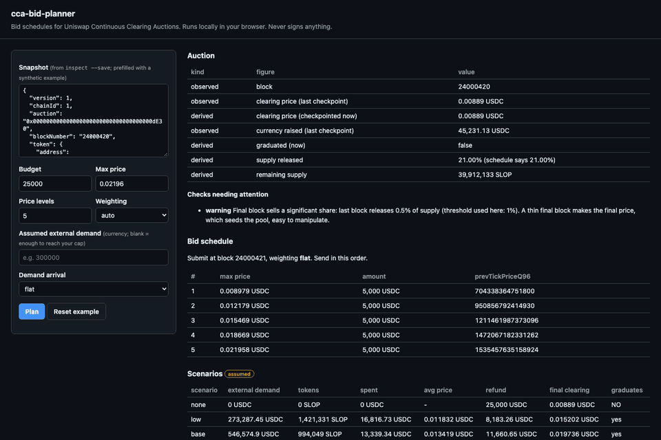

# cca-bid-planner

Read-only bid planner for Uniswap Continuous Clearing Auctions (CCA). Give it an auction, a budget and a demand assumption, and it returns a bid schedule, with expected fill, average price, worst case and refund exposure for each scenario.

**Website and planner: [cca-bid-planner.vercel.app](https://cca-bid-planner.vercel.app)** · [Docs](https://cca-bid-planner.vercel.app/docs) · [Changelog](CHANGELOG.md)

[](https://github.com/cocoa-butter/cca-bid-planner/actions/workflows/ci.yml)
[](LICENSE)




CCA is a uniform-price auction run in continuous time. The obvious strategy, one bid at your maximum price, works against you here:

- It fills at whatever the market clears at.
- It is outbid the moment demand passes your cap.
- It tells you nothing about how much of your budget comes back as a refund.

The right ladder depends on how much demand you expect from other bidders. Nobody publishes that number, so this tool makes you state it as an assumption and shows what happens under it.

It never holds keys and never signs anything. The `calldata` command encodes `submitBid` arguments for you to review and send with your own wallet.

## Install

```sh
# run without installing
npx github:cocoa-butter/cca-bid-planner --help

# or install the command
npm install -g github:cocoa-butter/cca-bid-planner
cca-bid-planner --help
```

Not yet published to the npm registry. Installing from GitHub builds the package on install.

Requires Node 22 or later. viem is the only runtime dependency.

## Commands

| Command    | What it does                                                                                                              |
| ---------- | ------------------------------------------------------------------------------------------------------------------------- |
| `inspect`  | Reads parameters and live state and prints a risk report. Every figure is labelled. `--save file.json` stores a snapshot. |
| `plan`     | Builds a bid schedule for `--budget` and `--max-price`, then simulates it under four demand scenarios.                    |
| `simulate` | Replays a given schedule (`--bid price:amount` or `--schedule plan.json`) against one scenario.                           |
| `calldata` | Emits `submitBid` calldata, with `prevTickPrice` hints and Permit2 or msg.value notes.                                    |
| `verify`   | Runs parameter sanity checks. Exit code 3 means a critical check failed.                                                  |

Each command takes either `--auction <address> --rpc <url>` (read-only JSON-RPC) or `--snapshot <file>`. Add `--json` for machine-readable output.

### `inspect`

```sh
cca-bid-planner inspect --auction 0x... --rpc https://ethereum-rpc.publicnode.com --save slop.json
```

```
Parameters and state
  [obs] floor price                        0.00889 USDC/SLOP
  [obs] required currency raised           400,000 USDC
  [der] full sale at floor raises          400,050 USDC
  [obs] clearing price (last checkpoint)   0.00889 USDC/SLOP
  [der] clearing price (checkpointed now)  0.00889 USDC/SLOP
  [der] graduated (now)                    false
  [der] supply released                    21.00% (schedule says 21.00%)
  ...
Risk checks
  [WARN] Final block sells a significant share
         last block releases 0.5% of supply (threshold used here: 1%). A thin final block
         makes the final price, which seeds the pool, easy to manipulate.
  [ ?  ] Checks this tool cannot do
         Not checkable from the auction contract: honeypot or fee-on-transfer token
         behaviour, the liquidity-launcher positionRecipient, ...
```

`[obs]` means read from chain, `[der]` means computed with protocol math, and `[asm]` means the figure depends on an assumption.

The samples here use `test/fixtures/demo-snapshot.json`. It is a **synthetic** auction built from illustrative $SLOP figures (unverified) (floor 0.00889 USDC, 45M supply, 400k USDC minimum raise), with invented prior bids. It is not a chain read.

### `plan`

```sh
cca-bid-planner plan --snapshot slop.json --budget 25000 --max-price 0.02196
```

```
Bid schedule (send in this order)
  #  max price            amount      maxPriceQ96       prevTickPriceQ96
  1  0.0089789 USDC/SLOP  5,000 USDC  711381748399318   704338364751800
  2  0.0121793 USDC/SLOP  5,000 USDC  964943559709966   950856792414930
  3  0.0154686 USDC/SLOP  5,000 USDC  1225548754668132  1211461987373096
  4  0.018669 USDC/SLOP   5,000 USDC  1479110565978780  1472067182331262
  5  0.0219583 USDC/SLOP  5,000 USDC  1739715760936946  1535457635158924

Scenarios [asm]: other bidders add X currency, spread across prices up to the ceiling
  scenario  external demand        tokens               spent               avg price             refund              final clearing        graduates
  none      0 USDC                 0 SLOP               0 USDC              -                     25,000 USDC         0.00889 USDC/SLOP     NO
  low       273,287.451369 USDC    1,421,331.7004 SLOP  16,816.735564 USDC  0.01183168 USDC/SLOP  8,183.264436 USDC   0.0152019 USDC/SLOP   yes
  base      546,574.902738 USDC    994,049.5286 SLOP    13,339.344169 USDC  0.01341919 USDC/SLOP  11,660.655831 USDC  0.0197358 USDC/SLOP   yes
  high      1,093,149.805476 USDC  536,408.5832 SLOP    7,336.591938 USDC   0.01367725 USDC/SLOP  17,663.408062 USDC  0.02484385 USDC/SLOP  yes
```

Options:

- `--levels n`: number of price levels. Default 5.
- `--weighting flat|top|bottom|auto`: how the budget is spread across the levels.
- `--demand X`: your assumption about external demand. Without it, `X` is the demand that would lift clearing to your cap.
- `--demand-ceiling`: highest price other bidders are assumed to pay.
- `--arrival early|flat|late`: when the external demand arrives.

`plan --json` output can be fed straight to `simulate --schedule` and `calldata --schedule`.

### `simulate` and `calldata`

```sh
cca-bid-planner simulate --snapshot slop.json --bid 0.012:10000 --bid 0.018:15000 --demand 300000
cca-bid-planner plan --snapshot slop.json --budget 25000 --max-price 0.02196 --json > plan.json
cca-bid-planner calldata --snapshot slop.json --schedule plan.json --owner 0xYourAddress
```

### Website

[cca-bid-planner.vercel.app/app](https://cca-bid-planner.vercel.app/app) runs the same planner in your browser. It reads an auction directly from a public RPC, so nothing goes through a server. You can also paste a snapshot from `inspect --save`.

The query string holds the inputs, so a plan can be shared as a link:

```
/app?chain=8453&auction=0x...&budget=40000&maxPrice=0.018&demand=300000
```

Build and preview the site locally with `npm run dev:site`.

### Library

```ts
import { readSnapshot, clientFor, plan, toPriceQ96, toRaw } from 'cca-bid-planner';

const { snapshot } = await readSnapshot(clientFor(rpcUrl), auction);
const result = plan(snapshot, {
  budget: toRaw('25000', snapshot.currency.decimals),
  maxPrice: toPriceQ96('0.02196', snapshot.token.decimals, snapshot.currency.decimals),
});
```

The pure core, which has no I/O, is also exported as `cca-bid-planner/core`.

## How the math works

The simulator is a bigint port of the contract's checkpoint, clearing-price and fill accounting, with the contract's rounding. `test/differential.test.ts` replays random auctions on the real `ContinuousClearingAuction` (v2.1.0) with Foundry and compares the results. Across 300 auctions and 2,405 bids, every fill, refund, clearing price and raise is equal to the wei.

[docs/MATH.md](docs/MATH.md) has the formulas with worked examples. [docs/RISKS.md](docs/RISKS.md) maps each bidder risk to the check that covers it. [docs/ABI.md](docs/ABI.md) records where the ABI came from.

## What this cannot tell you

- **The demand forecast is an assumption.** Every expected fill and price is conditional on it and is labelled `[asm]`. This is a scenario calculator, not a price oracle.
- **Auctions can fail to graduate.** If `currencyRaised` never reaches `requiredCurrencyRaised`, every bid is refunded in full and no tokens are sold. The `none` scenario usually shows this.
- **Exits are restricted.**
  - Nothing can be exited before the auction graduates.
  - A bid that is filled, or sits at the final clearing price, can only exit after the end block.
  - An outbid bid can exit early, but only once the auction has graduated.
- **Clearing can move before your transaction lands.** A bid at or below the clearing price at inclusion reverts.
- **Not checkable from the auction contract:**
  - honeypot or fee-on-transfer tokens
  - the liquidity-launcher `positionRecipient`
  - whether the floor price is fair

## Out of scope

- Signing, key management and transaction submission.
- Price prediction.
- Non-CCA auctions.
- Fee-on-transfer tokens and tokens with fewer than 6 decimals, which are unsupported upstream.
- Portfolios spanning several auctions.

## Credits

The Continuous Clearing Auction mechanism and contracts are by Uniswap Labs:

- Contracts: [Uniswap/continuous-clearing-auction](https://github.com/Uniswap/continuous-clearing-auction) (MIT). This tool pins `v2.1.0`.
- Whitepaper: [docs/assets/whitepaper.pdf](https://github.com/Uniswap/continuous-clearing-auction/blob/main/docs/assets/whitepaper.pdf) in that repository.
- Uniswap docs: [Continuous Clearing Auction](https://docs.uniswap.org/contracts/liquidity-launchpad/CCA).

What comes from the protocol:

- the ABI
- the constants
- the arithmetic that `src/core/engine.ts` ports

What this project adds:

- the planner (ladders, weighting and scenarios)
- the simulator harness and the differential test against the real contract
- the risk report and its labelling
- the CLI and the demo page

This project is not affiliated with or endorsed by Uniswap Labs. See [NOTICE](NOTICE) and [THIRD_PARTY_LICENSES.md](THIRD_PARTY_LICENSES.md).

## Contributing

Issues and pull requests are welcome. See [CONTRIBUTING.md](CONTRIBUTING.md) and the [code of conduct](CODE_OF_CONDUCT.md). Report security issues privately, as described in [SECURITY.md](SECURITY.md).

## License

[MIT](LICENSE)
